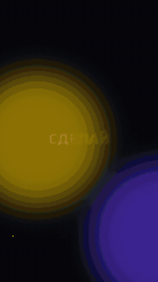

# Reel Factory

**Beat-synced short video montage for Reels, TikTok and Shorts — driven by Claude Code or Codex.**

[Русская версия](README.ru.md)



You drop clips, photos and a track into a folder and tell your AI agent what you want, in plain words:
*"make a dynamic 30-second edit to this track, title CHAMPION on the drop"*. The agent uses the `reel` tools to
watch the footage, cut on the beat, add titles, subtitles, motion graphics and voice-over, check its own render
frame by frame and export files for every platform.

Everything runs locally with ffmpeg. Paid AI services are optional and use your own keys.

- **Beat montage** — an editable JSON edit list where every cut lands on a real beat; zoom, push-in, slow motion,
  flashes, shake, colour look
- **Automatic montage** — picks the sharpest, most dynamic moments from a folder and cuts them to the music
- **Titles and kinetic text** — Latin and Cyrillic fonts included, social safe zones respected
- **Premium animated text with Remotion** — springy kinetic titles, TikTok-style word captions with a highlight pill,
  title cards with mask reveal, stacking lists; over video, a gradient or transparent
- **Motion design from code** — the agent writes an HTML/JS animation, `reel motion` renders it frame by frame to MP4
  or transparent MOV; templates for kinetic type, stat counters and lower thirds
- **Speech subtitles** — local Whisper, bold / clean / karaoke styles, SRT export
- **Reframe** — remove black bars, 16:9 to 9:16 with crop or blurred fill, 4:5, 1:1
- **Export** — Reels / TikTok / Shorts presets, loudness at -14 LUFS
- **The agent can watch video** — contact sheets with timecodes plus a word-level transcript
- **Download** — YouTube, TikTok, Instagram, VK and more through yt-dlp, whole or a time range
- **Voice-over** — ElevenLabs with your key, music ducks under the voice
- **AI shots** — images and video through kie.ai (Nano Banana, Veo 3.1) with your key; the price is shown first
- **Agent mode** — many agents at once: editors for several variants, a motion designer, a captioner, a
  scriptwriter and QA in parallel, as Claude Code subagents, headless Claude/Codex workers (`reel crew`) or Ruflo swarms;
  `reel batch` renders many jobs in parallel
- **Hooks and scripts** — a cheat sheet of 20 hook types, retention tricks and endings for the agent

## Install on an empty computer

Open Claude Code or Codex on the new computer and paste:

> Install Reel Factory from https://github.com/Shahen777/reel-factory on this computer. Follow SETUP.md in that repo step by step and check that everything works.

The agent runs the bootstrap, which installs git, ffmpeg, Python, Node.js and yt-dlp if missing, then everything else.
If a step needs your password (Homebrew on macOS, apt on Linux), the agent shows you the exact command to run.

Or run it yourself:

```bash
# macOS / Linux
curl -fsSL https://raw.githubusercontent.com/Shahen777/reel-factory/main/scripts/bootstrap.sh | bash
```

```powershell
# Windows (PowerShell)
irm https://raw.githubusercontent.com/Shahen777/reel-factory/main/scripts/bootstrap.ps1 | iex
```

## Install by hand

You need Python 3.10+ and ffmpeg (Node.js 18+ for Remotion).

```bash
# macOS
brew install ffmpeg
# Ubuntu / Debian
sudo apt install ffmpeg
# Windows
winget install Gyan.FFmpeg
```

```bash
git clone https://github.com/Shahen777/reel-factory.git
cd reel-factory
./scripts/install.sh            # or: pip install -e ".[all]"
reel doctor
```

`./scripts/install.sh --skills` also copies the skills to `~/.claude/skills` and `~/.agents/skills`, so they work in
any folder, not only inside this repo.

Try it without any footage: `python3 examples/make_demo.py` renders `out/demo.mp4` from generated test media.

## Use with Claude Code

```bash
cd reel-factory
claude
```

Then just talk:

- "Here are clips in media/trip. Make a dynamic 30 s Reel to media/trip/track.mp3, two variants."
- "Add karaoke subtitles to media/talk.mp4, Russian."
- "Make a kinetic title intro: SUMMER DROP, yellow accent, on the beat of track.mp3."
- "Remove the black bars from this video and make it vertical."
- "Write three hooks and a script for a video about our new coffee."

Claude reads `CLAUDE.md` / `AGENTS.md` and the skills in `.claude/skills/` automatically.

## Use with Codex

```bash
cd reel-factory
codex
```

Codex reads `AGENTS.md` and the same skills through `.agents/skills/`. Ask in the same plain words.

## Commands

| command | what it does |
|---|---|
| `reel montage edl.json [--preview]` | render a beat-locked edit, format in [docs/EDL.md](docs/EDL.md) |
| `reel auto FOLDER --music TRACK --duration 30 --style punchy` | automatic edit, writes an editable EDL |
| `reel remotion KineticTitle --set 'lines=["HI","*THERE*"]'` | Remotion text: KineticTitle, Captions, TextReveal, ListStack |
| `reel motion kinetic --set text="HELLO" --music TRACK` | motion design from HTML/JS (`reel motion list`) |
| `reel subtitles VIDEO --lang ru --style karaoke` | Whisper subtitles, SRT |
| `reel reframe VIDEO --aspect 9:16` | remove black bars, reframe |
| `reel export VIDEO --all` | Reels, TikTok and Shorts files |
| `reel watch VIDEO [--dense 3-6]` | contact sheets + transcript for the agent |
| `reel download URL [--section 0:10-0:25]` | download video or audio |
| `reel crew plan.json [--engine codex]` | agent mode, see [docs/AGENT_MODE.md](docs/AGENT_MODE.md) |
| `reel batch jobs.json` | many renders in parallel with dependencies |
| `reel beats TRACK` | tempo and beat times |
| `reel voice list` / `reel voice say ...` | ElevenLabs voice-over |
| `reel kie price veo` / `image` / `video` | kie.ai generation, runs only with `--yes` |

Keys for paid services go into `.env` (copy `.env.example`). `.env` is git-ignored.

## How an edit looks

```json
{
  "music": "track.mp3",
  "segments": [
    {"type": "video", "src": "clips/a.mp4", "in": 3.2, "beats": 2, "push": 0.1, "flash": 0.08},
    {"type": "photo", "src": "photos/p1.jpg", "beats": 2},
    {"type": "video", "src": "clips/wide.mp4", "in": 10, "beats": 4, "fit": "4x5", "speed": 0.5}
  ],
  "titles": [{"text": "CHAMPION", "at_beat": 0, "beats": 4, "anim": "pop"}]
}
```

Lengths are in beats, so changing the track or the tempo keeps every cut on the rhythm.

## Responsible use

Use footage, music and voices you own or have licensed. The tools and skills refuse deepfakes, face swaps,
voice clones or lipsync of real people without consent, fake "leaked" footage and election campaigning, and they
never try to get around sign-in walls or bot checks. If a safety filter blocks a generation, change the idea.

## License

MIT. Bundled fonts (Russo One, PT Sans) are under the SIL Open Font License.
Remotion has its own licence: free for individuals and companies of up to 3 people, a company licence otherwise
(see remotion.dev/license).
