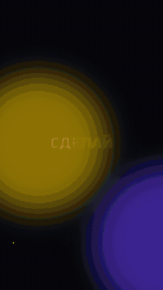

# Reel Factory

**Монтаж коротких видео под бит для Reels, TikTok и Shorts. Управляется через Claude Code или Codex.**

[English version](README.md)



Кладёте клипы, фото и трек в папку и пишете ИИ-агенту обычными словами:
*«сделай динамичный ролик на 30 секунд под этот трек, на дропе титр ЧЕМПИОН»*. Агент через команды `reel`
смотрит материал, режет на бит, добавляет титры, субтитры, моушн-графику и озвучку, сам проверяет готовый ролик
по кадрам и выгружает файлы под каждую площадку.

Всё работает на вашем компьютере через ffmpeg. Платные ИИ-сервисы по желанию, со своими ключами.

- **Монтаж под бит.** Сценарий монтажа в JSON, каждая склейка попадает на настоящий бит. Зум, наезд, слоу-мо,
  вспышки, тряска, цветокор
- **Автомонтаж.** Сам выбирает самые резкие и динамичные моменты из папки и режет их под музыку
- **Титры и кинетический текст.** Шрифты с кириллицей в комплекте, безопасные зоны соцсетей
- **Моушн-дизайн кодом.** Агент пишет анимацию на HTML/JS, `reel motion` снимает её покадрово в MP4 или в MOV
  с прозрачным фоном. Шаблоны: кинетический текст, счётчик цифр, плашка с именем
- **Субтитры по речи.** Whisper на вашем компьютере, стили bold, clean и караоке, выгрузка SRT
- **Кадрирование.** Убирает чёрные полосы, переводит 16:9 в 9:16 обрезкой или с размытым фоном, 4:5, 1:1
- **Экспорт.** Готовые настройки для Reels, TikTok и Shorts, громкость -14 LUFS
- **Агент видит видео.** Листы кадров с таймкодами и расшифровка речи по словам
- **Скачивание.** YouTube, TikTok, Instagram, VK и другие сайты через yt-dlp, целиком или кусок
- **Озвучка.** ElevenLabs с вашим ключом, музыка приглушается под голос
- **ИИ-кадры.** Картинки и видео через kie.ai (Nano Banana, Veo 3.1) с вашим ключом, цена показывается до запуска
- **Хуки и сценарии.** Шпаргалка для агента: 20 типов хуков, приёмы удержания и концовки

## Установка

Нужны Python 3.9+ и ffmpeg.

```bash
# macOS
brew install ffmpeg
# Ubuntu / Debian
sudo apt install ffmpeg
# Windows
winget install Gyan.FFmpeg
```

```bash
git clone https://github.com/Shahen777/reel-factory.git
cd reel-factory
./scripts/install.sh            # или: pip install -e ".[all]"
reel doctor
```

`./scripts/install.sh --skills` ещё и копирует навыки в `~/.claude/skills` и `~/.agents/skills`, тогда они работают
в любой папке, а не только внутри репозитория.

Попробовать без своих видео: `python3 examples/make_demo.py` соберёт `out/demo.mp4` из тестовых файлов.

## С Claude Code

```bash
cd reel-factory
claude
```

И просто пишите:

- «Вот клипы в media/trip. Сделай динамичный рилс на 30 секунд под media/trip/track.mp3, два варианта.»
- «Добавь караоке-субтитры к media/talk.mp4, русский язык.»
- «Сделай заставку с кинетическим текстом ЛЕТНИЙ ДРОП, жёлтый акцент, под бит track.mp3.»
- «Убери чёрные полосы с этого видео и сделай вертикальным.»
- «Скачай этот ролик с YouTube и разбери, почему он залетел.»
- «Придумай три хука и сценарий ролика про наш новый кофе.»

Claude сам читает `CLAUDE.md`, `AGENTS.md` и навыки из `.claude/skills/`.

## С Codex

```bash
cd reel-factory
codex
```

Codex читает `AGENTS.md` и те же навыки через `.agents/skills/`. Пишите теми же словами.

## Команды

| команда | что делает |
|---|---|
| `reel montage edl.json [--preview]` | монтаж под бит, формат в [docs/EDL.md](docs/EDL.md) |
| `reel auto ПАПКА --music ТРЕК --duration 30 --style punchy` | автомонтаж, сохраняет сценарий для правки |
| `reel motion kinetic --set text="ПРИВЕТ" --music ТРЕК` | моушн-дизайн из HTML/JS (`reel motion list`) |
| `reel subtitles ВИДЕО --lang ru --style karaoke` | субтитры Whisper, SRT |
| `reel reframe ВИДЕО --aspect 9:16` | убрать полосы, перекадрировать |
| `reel export ВИДЕО --all` | файлы для Reels, TikTok и Shorts |
| `reel watch ВИДЕО [--dense 3-6]` | листы кадров и расшифровка для агента |
| `reel download ССЫЛКА [--section 0:10-0:25]` | скачать видео или звук |
| `reel beats ТРЕК` | темп и время битов |
| `reel voice list` / `reel voice say ...` | озвучка ElevenLabs |
| `reel kie price veo` / `image` / `video` | генерация через kie.ai, запуск только с `--yes` |

Ключи платных сервисов кладите в `.env` (скопируйте `.env.example`). Файл `.env` в git не попадает.

## Честное использование

Используйте свои или лицензированные видео, музыку и голоса. Инструменты и навыки не делают дипфейки, замену лиц,
клоны голоса или липсинк реальных людей без согласия, фейковые «слитые» видео и предвыборную агитацию, и не обходят
входы по логину и проверки на бота. Если фильтр безопасности блокирует генерацию, меняйте идею.

## Лицензия

MIT. Шрифты в комплекте (Russo One, PT Sans) под лицензией SIL Open Font License.
